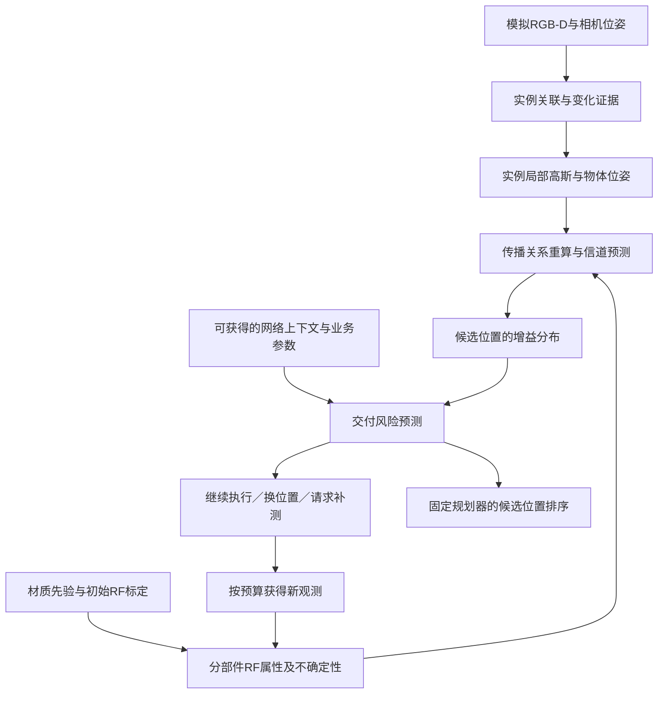

# 动态环境中基于实例高斯地图的信道更新与通信时延风险预测

版本：2026-11-04。阶段：研究计划，尚无本项目实验结果。资源约束：目前只有电脑，优先仿真，不以购买机器人或射频设备为启动条件。

英文工作题目：**Instance-Centric Gaussian Maps for Risk-Aware Channel Updating and Communication Delay Prediction in Dynamic Environments**。

配套文件：[详细工作路线](02_详细工作路线.md)、[文献核验与主张边界](03_文献核验与主张边界.md)。

## 1 研究摘要

室内机器人可以通过视觉与深度观测发现柜子搬移、门打开等环境变化，但变化后的信道知识地图可能在新的无线测量到来之前失效。已有工作已经支持视觉与无线统一表征、物体级电磁属性学习和动态场景编辑。本研究拟进一步考察：当机器人只能观察部分表面，物体身份、位姿和材质均有误差时，哪些信道预测仍足以支持通信决策，哪些区域需要补充测量。

本方案以实例为单位维护局部坐标系中的三维高斯几何、分部件材质先验、存在状态和独立的不确定性记录。物体发生变化后，系统迁移可复用的几何与材质知识，重新计算传播关系，并通过多假设预测估计信道变化的不确定性。在此基础上，结合可观测的网络负载与业务配置预测交付失败风险，决定继续使用预测、移动到更可靠的位置，或进行预算受限的无线补测。

实验分为物理机制、感知误差、网络时延和机器人决策四个阶段。采用独立场景模型产生射频参考结果，以分组级网络仿真产生通信延迟标签，并严格分离参考真值与算法输入。首先验证平均信道增益更新，再研究固定本地服务器业务的时延风险；云端VLM任务、毫米波波束控制和完整开放词汇导航作为后续扩展。本研究不预设3DGS、语义先验或主动补测一定优于简单方法，其作用通过同信息、同预算的对照实验检验。

## 2 从原方案保留什么，改变什么

| 原方案内容 | 新版处理 | 原因 |
|---|---|---|
| SuperMap提供实例与变化信息 | 保留其接口和思想；先用仿真观测，后接视觉估计 | 无机器人也能启动，避免同时复现整套系统 |
| 使用3DGS维护几何 | 保留，但验证相对点云／网格的代价与收益 | 更换表示本身不构成创新 |
| 共享几何与独立RF属性 | 保留；必要时从高斯提取RF表面代理 | 光学不透明度、椭球厚度不能直接充当电磁参数 |
| 开放词汇推断材质 | 降为可消融的先验来源 | 物体类别不唯一确定真实材质 |
| 零测量瞬间准确自愈 | 改为“限定窗口内无新增RF输入的预测更新” | 预测准确度与适用范围必须验证 |
| 物体绑定＋搬移复用作为首要创新 | 改为已有基础能力 | RFScape已经覆盖物体级RF表示及视觉驱动动态更新 |
| 全空间毫秒级CKM | 改为固定查询预算下的延迟与精度曲线 | 单点渲染速度不能替代完整系统时延 |
| 根据位置直接预测延迟 | 改为条件化的交付风险预测 | 网络负载、协议和业务大小必须纳入 |
| VLM、波束控制、6D CKM同时展开 | 从第一阶段移出 | 控制范围，优先回答可证伪的核心问题 |

## 3 文献定位与尚待证明的差异

SuperMap提供在线时空实例地图与场景图，可作为感知接口，但不应宣称其完全没有重关联能力。[1] URF-GS与CORF-GS已经覆盖视觉／无线共享几何及增量重建问题。[3–4] GS-CG研究稀疏无线测量驱动的动态平均增益图更新。[5]

更直接的对照是RFScape。其§4.4.2已经讨论利用视觉获得物体身份与位姿，并将传播计算变换到物体原坐标系以复用表示。因此，“看到物体移动就更新无线场”不能直接写成首次贡献。[2] MapViT也研究动态环境与无线质量地图预测。[7] 材质信息的必要性不能预设，有工作在其单房间实验中发现二值占据表示并不弱于详细材质编码。[8]

**待验证的差异**是：在不完整、存在错误的实例观测下，如何把“属性可迁移程度、传播预测误差、网络背景波动”区别开来，并把不确定性转化为补测或导航决策。仅采用高斯、集成模型、置信区间或主动学习都不是单独成立的新贡献。必须证明提出的对象条件化处理在强基线上有独立增益；否则将成果定位为系统集成或评测研究。

## 4 研究问题与假设

| 编号 | 问题 | 拟检验的假设 | 否证条件 |
|---|---|---|---|
| H1 | 搬移后能否复用初始RF知识？ | 在未见位姿下，实例属性迁移优于冻结地图，并在误差或更新时间上优于同信息的直接重算 | 仅在准确位姿／准确材质上成立，或简单代理已经同样好 |
| H2 | 如何处理感知误差？ | 对身份、位姿、材质和可见性进行分别建模，可降低“错误预测为安全”的比例 | 简单残差置信度或统一噪声模型达到同样效果 |
| H3 | 补测哪里更有用？ | 面向实际决策损失的补测优于同预算随机、均匀与最大方差采样 | 只胜过无补测，或采样位置使用了测试真值 |
| H4 | 动态地图能否帮助预测延迟？ | 在可观测网络状态相同条件下，更新后的信道特征改善未到达位置的交付风险预测 | 网络状态／近期历史足以解释全部收益 |
| H5 | 是否改善机器人任务？ | 在相同规划器下，风险地图减少超时或失败，同时控制绕行与等待 | 只有平均延迟下降，任务成功率未改善或代价过高 |

H1–H3构成主要方法证据；H4–H5构成应用证据。若只得到H1的工程可行性，不将其包装为完整创新。

## 5 问题设定与术语

### 5.1 第一版范围

采用固定单接入点、固定频段、固定发射功率和天线配置。先以5 GHz Wi-Fi场景、地面移动接收端和本地服务器为仿真设定。频段与设备参数是研究配置，不是对真实无线设备的部署建议。环境变化以刚体平移、旋转、移除以及门铰链运动为主；人体非刚体运动后置。

第一版CKM输出是固定配置下的**局部平均信道功率增益**，统一用线性值内部计算、dB报告。接收功率由发射功率与增益换算；天线增益计入哪一项必须固定，避免重复计入。RSSI是设备测量语义，仿真量没有设备模型时称“接收功率”，不冒称真实RSSI。

第一版延迟任务为固定大小UDP数据报到本地接收端的单向交付延迟，并把截止时间前未交付作为失败。图像上传完成时间另设独立TCP／应用层实验，不能用小包RTT代替。

### 5.2 术语表

| 术语 | 本文约定 | 不混用为 |
|---|---|---|
| CKM | Channel Knowledge Map，信道知识地图 | 任意网络性能图 |
| CGM | Channel Gain Map，本文CKM的具体输出 | 瞬时复数CSI |
| 通信时延风险地图 | 给定位置、配置、可用网络上下文和业务的交付风险 | 位置固有的固定延迟 |
| 高斯几何协方差Σ | 表示高斯形状与尺度 | 位姿估计置信度 |
| 位姿不确定性Q | 估计误差或多假设分布 | 高斯自身大小 |
| 无新增RF输入 | 冻结窗口内预测器不读取新RF／通信结果 | 全系统永不测量、无监督标签 |
| 参考结果 | 仿真器在限定传播与网络模型下的结果 | 真实世界绝对真值 |
| 实时 | 在声明硬件、输入频率和查询预算下满足截止时间 | 仅渲染FPS较高 |

### 5.3 信息可见性

设置三个独立实验轨道，禁止混报。

- **O轨道，机制上限**：给定准确实例ID与位姿；准确材质另作为上限，主设置仍需要先验／初始标定。
- **P轨道，受控误差**：从O轨道注入预定义的位姿偏差、漏检、ID混淆和部分可见性。这是敏感性实验，不是完成了真实感知。
- **V轨道，观测输入**：算法仅接收模拟RGB-D、允许的相机位姿和检测／跟踪输出；场景真值标签仅供评分。先使用已知相机位姿，再单独研究视觉里程计误差。

## 6 方法设计

### 6.1 总体架构

与前面讨论的三层地图对应，本方案拟采用以下分工；这是对研究系统的设计，不是声称SuperMap原文已经实现这些无线能力。

| 层／服务 | 保存与处理的信息 | 与其他模块如何协作 |
|---|---|---|
| 几何层 | 观测到的表面、实例局部高斯、相机／物体变换、可见性与占据证据 | 给实例层提供形状与变化证据，给RF计算提供可验证的几何代理 |
| 实例层 | 稳定ID及关联候选、部件、材质先验／后验、存在状态、位姿和参数版本 | 物体变化时指出哪些几何与RF参数可以复用、哪些需要失效化 |
| 拓扑／场景图层 | 目标实例与空间关系；另维护可达路点和路径连接 | 语言目标落到实例，导航在可达图上查询沿途通信风险；语义关系边不自动等于可通行边 |
| CKM与风险查询服务 | 给定位置、时间、无线配置和网络上下文的增益分布及交付概率 | 读取几何与实例状态，将风险返回候选节点／路径，并提出补测动作 |

通信延迟随网络上下文变化，不作为永远固定的标量写在每个高斯上。场景图和可达图可通过实例ID／区域ID连接；后者的通信代价带地图版本与有效期。

### 6.2 实例地图和数据结构

实例j表示为：

\[
O_j(t)=\{ID_j,\mathcal G_j^{local},T_j(t),\mathcal P_j,
p_j(m),\theta_j,Q_j(t),e_j(t),v_j(t)\}.
\]

其中，局部高斯集合包含中心、尺度／旋转、颜色、光学不透明度和部件ID；T是实例局部系到世界系的变换；P是RF表面代理；p(m)是材质类别先验；θ是当前可辨识的有效传播参数；Q是估计不确定性；e是存在状态；v包括观测时间与地图版本。

建议分开保存以下表。

| 表 | 必要字段 |
|---|---|
| Gaussians | gaussian_id、instance_id、part_id、local_mean、scale、rotation、optical_opacity、color／SH |
| Instances | instance_id、class、world_pose、pose_uncertainty、existence、last_seen、geometry_version |
| RFParts | instance_id、part_id、surface_proxy、normal、thickness_prior、material_probs、RF_params、parameter_source、calibration_version |
| RadioConfig | Tx位置、功率、频率、带宽、天线／极化配置、Rx高度与方向约定 |
| RFObservations | 时间、位置、朝向、配置ID、观测值、噪声模型、可用时间、split、样本成本 |
| Predictions | query位置、环境版本、配置版本、增益分布、交付概率、uncertainty、valid_until |
| NetworkContext | 时刻、可用的历史忙碌率／近期统计、统计窗口、接收时间、是否oracle |

材质共享于部件表，避免每个高斯重复存大向量。对新物体未见表面保存unknown／coverage，不把不可见区域默认为空。门作为可动部件维护铰链／位姿；“柜子”不能自动等同于实心均匀金属。

### 6.3 高斯几何与RF代理的关系

视觉高斯的Σ不是实体厚度，α_opt不是电磁透射率。第一版不强行让每个高斯成为独立物理散射体。通过观测深度和局部高斯的平面一致性形成有限表面片，另存法向、边界和厚度先验；对薄片法向的估计以深度支持和正则约束验证，不仅依赖最小特征向量。

这是一种“实例高斯地图＋RF表面代理”的实现。若最终RF计算全部依赖代理，而高斯本身没有带来精度、更新成本或视觉共享优势，论文不得声称高斯电磁原语是主要贡献。必须设置直接使用同样观测构建的点云／平面／网格代理对照。

在尺度、协方差优化和高斯增密后保持物理代理的一致性，防止“多复制一个高斯就多吸收一次信号”。独立的增密不变性检查是实现门槛。

### 6.4 可迁移参数与变动状态分离

刚体运动时：

\[
\mu^W_k(t)=R_j(t)\mu^{local}_k+t_j(t),\qquad
\Sigma^W_k(t)=R_j(t)\Sigma^{local}_kR_j(t)^\top.
\]

局部形状和未变化的材质后验可以复用；世界中的遮挡、入射方向、出射方向和多径路径重新计算。方向相关函数应在物体局部坐标系求值，输入方向乘以R的逆；不把旧世界坐标的方向系数原样搬移。若物体结构发生变化或新部件出现，标记局部参数失效，按新对象处理。

### 6.5 第一版信道预测器

先采用直达、穿透及一阶镜面反射的可解释近似，通过当前RF代理搜索有效路径，以物体／部件共享的少量参数计算路径功率。限定在局部平均尺度适合非相干功率叠加的设置下：

\[
\widehat g(q,t)=\sum_{p\in\widehat{\mathcal P}(q,t)}|a_p(\widehat M_t,\theta,f)|^2.
\]

该近似不等于完整瞬时CSI；平均尺度和参考生成方式要冻结，并在强相干、绕射占优、复杂多径场景单独报告失效。参考模型可包含更多反射／散射机制，以避免方法只是复算同一个公式。Sionna RT支持场景交互和无线地图计算，但其支持范围与近似也需逐项记录。[9]

初始标定阶段只拟合少量有效反射／穿透参数，并施加先验或范围约束；不在单接入点少量标量观测下同时自由反演所有介电参数、厚度、几何和散射函数。几何先固定，再做参数标定；如果多个参数解同样解释数据，保留不确定性，不宣称恢复了真实材料。

第一版不额外堆叠大网络。物理近似有系统残差时，才比较一个小的对象局部响应网络；它不能以世界位置记忆测试布局，且需要与同容量全局残差模型比较。

### 6.6 变化传播与不确定性

物体变化后，先失效化旧传播依赖，再在旧位置、新位置及关联查询路径上搜索新增／消失的传播关系。旧路径索引只能加速已知依赖，不能替代新路径发现。未知远场影响采用保守扩展或全量回退，并计入成本。

对有限组身份、位姿和材质假设进行传播，得到查询位置的增益分布或样本集合。把三类不确定性分开记录：

1. 几何／关联不确定性，由感知历史或预定义误差模型提供；
2. 参数不确定性，由初始标定和先验提供；
3. 模型失配，由独立校准布局上的残差估计。

模型分歧不是天然校准概率。需要在CAL布局检查覆盖率、误差排序和拒绝预测后的风险。分布外情形只报告经验行为，不承诺固定概率保证。

**可直接实现的第一版推断。** 为每个变化实例保留少量位姿／身份／材质候选，并组合成有权重的场景假设\(H^{(m)}\)。视觉变化观测用于更新位姿与关联权重；当身份可信、结构未改变时，沿用对应局部材质参数后验。新物体从先验初始化；身份不确定时保留多个候选，不把旧材质强行赋给新对象。对每个假设重算传播，形成加权增益分布，并叠加独立校准的模型残差。

真正收到测量\(y_s\)后，以预先校准的测量似然更新权重：

\[
w_m^+ \propto w_m^-\,p(y_s\mid \widehat g(s;H^{(m)}),\text{测量噪声与模型残差}).
\]

在冻结窗口内禁止这一RF更新，只允许视觉证据改变状态。某次RF测量可能同时支持多个材质／位姿解释，因此权重更新并不保证真实参数可辨识。假设过度集中或新观测落在全部假设之外时，扩大候选或标记当前预测不可用，不能仅归一化出一个虚假的高置信答案。上述设计是待比较的有限多假设基线式实现；论文贡献需由对象条件化处理相对统一误差模型的消融来建立。

### 6.7 条件化的通信交付风险

令D为固定源、固定目标及指定业务的数据报交付延迟。超时／未到达不强行当作一个普通有限延迟值。主要预测目标为：

\[
q_\tau(x,t)=P(\text{在}\tau\text{内交付}\mid
\widehat g(x,t),U_g(x,t),z_t,b,\text{配置}).
\]

z_t仅包含决策时已经可获得的网络上下文，b包含包大小、发送频率和协议等。先用逻辑回归／梯度提升树作为模型，分别比较位置-only、网络上下文-only、冻结CKM、动态CKM和动态CKM＋不确定性。到达报文的条件P50／P95延迟作为辅助输出；若足够多报文失败，不把成功子集的P95称为无条件尾部延迟。

第一版主要做当前场景下的空间查询；短期动作预测需声明“有效期内场景近似不变”的条件。查询未来到达位置时不能读取真实未来动态脚本。超过有效期则重新观测与规划，或扩大不确定性；预测物体未来运动是独立扩展，不因使用4D场景图就自动具备。

参考标签来自ns-3的PHY／MAC、队列和流量过程，而不是用Sionna传播时延或L/R直接充当完整通信延迟。ns-3传播损耗与传播时延是不同接口；信道增益影响接收功率，分组级机制再产生交付结果。[10–11] 单向延迟、时钟定义和超时阈值依据预先固定的测量协议。[12]

### 6.8 面向决策的预算补测

动作包括沿原计划执行、移动至另一候选位置、在可达位置采集一批RF样本。采用固定的任务损失函数L，其中包括超时／失败、移动和测量成本。候选测量点s的价值定义为当前后验下的预计决策损失下降：

\[
V(s)=\min_a\mathbb E[L(a)\mid\mathcal H_t]
-\mathbb E_{y_s\mid\mathcal H_t}
\left[\min_a\mathbb E[L(a)\mid\mathcal H_t,y_s]\right]
-\lambda C(s).
\]

外层可能观测从当前模型预测分布中采样，不能查参考真值；只有真正选择并执行s后，才允许取得该处观测。第一版只做有限候选和一步前瞻，不开发复杂强化学习。该目标属于已有决策论思路，创新必须来自对象不确定性的建模及其实际增益，而不是公式本身。

预算同时记录测量位置数、位置内包数、等待时间和行驶距离。提供最大方差、随机、均匀、变化位置附近采样等同预算强对照。若泛化差，回退到经过CAL冻结的简单阈值策略。

### 6.9 导航与语言接口

先在相同可达性地图和候选动作集合上固定规划器，仅替换其通信代价输入。场景图负责把指令定位到目标实例；路径规划负责沿途可达性及通信风险，不能只选择信号好的终点。

路径评价按预计到达时刻查询风险，并采用滚动更新。同一遮挡或拥塞会使相邻点风险相关，不能无条件把各点成功率相乘当作整段成功率；可先使用保守最大风险代价，并与共享场景／流量样本的路径评估比较。

第一版使用模板指令和确定性解析，避免语言模型错误混入核心对比。后续接VLM时，所有方法共用同一个语言定位模块与相同目标ID。上传图像和云端推理另行测量，云端计算波动不归因于空间地图。

## 7 仿真实验设计

### 7.1 参考世界和算法世界隔离

参考世界保留完整网格、真实部件材质、动态脚本和流量种子，供RGB-D渲染、RF参考和ns-3驱动。算法只获得声明可见的传感器流、初始标定和已授权的在线观测。真值目录不得被预测器或规划器导入；准确位姿／材质实验必须带oracle标记。

参考RF模型与被测方法不使用同一份估计几何、同一套可调参数或同一份训练输出。相同引擎也不能消除模型偏差，须加入反射阶数、材质扰动、几何误差和不同建模假设的敏感性实验。

### 7.2 数据规模与划分

先做6个布局的探索试验，按3 TRAIN／1 CAL／2 DEV划分；所有探索输出都属于开发数据。正式实验另生成12个布局，按6 TRAIN／2 CAL／4 TEST划分。数量是初始工程预算，不是统计充分性的保证；在看TEST前，可依据开发阶段的事件级方差调整并登记正式规模。

同一底层布局的不同材质、物体位姿、负载与相邻时刻全部进入同一划分。另设未见物体形状／材质组合压力测试；不能仅把连续视频或相邻栅格随机分成训练与测试。

每个布局覆盖平移、旋转、移除、门开启、遮挡恢复、多个相似物体，以及“只有负载变化、环境不变”的负对照。网络随机种子用于估计随机性，不当成新的独立房间。

### 7.3 RF输入协议

- 初始标定预算拟比较8／16／32个可达位置，所有方法一致；每位置重复观测次数与噪声模型固定。
- **严格冻结协议**：变化后所有预测器禁止读取新RF值、交付反馈及泄漏这些结果的近期通信统计，直到预设窗口结束。隐藏评测探针仅用于评分。
- **部署上下文协议**：允许当前可观测网络遥测，并对所有方法等量开放；不称为“完全无新增无线信息”。
- **补测协议**：变化后允许0／2／5／10个位置批次，逐次计费；补测结果从获取完成时才可使用。
- 历史通信包能否用作训练／适配数据必须单独声明；不能一边读取包的RTT／RSSI，一边宣称零新测量。

### 7.4 对照与消融

| 对照组 | 用途 | 公平性要求 |
|---|---|---|
| 冻结地图 | 测环境变化造成的退化 | 同初始标定 |
| 纯几何占据／固定材质代理 | 检验语义和材质先验是否必要 | 同观测几何、同参数预算 |
| 同观测网格／平面代理重算 | 检验高斯表示的独立价值 | 不给其完整真值网格 |
| 物体可迁移RF模型 | 与RFScape路线比较 | 复现状态、初始化和传感器条件明确 |
| GS-CG类稀疏RF更新 | 与测量驱动动态更新比较 | 同初始数据、同变化后采样预算 |
| URF-GS／CORF-GS适配 | 视觉无线表示强基线 | 修改原任务时注明适配版，不能当作作者原始结果 |
| 小型地图预测网络 | 排除复杂架构的必要性 | 同地图输入与训练布局 |
| 去实例／去材质／去不确定性 | 分离模块贡献 | 保持其他部分及调参预算一致 |
| 随机／均匀／最大方差／启发式补测 | 验证测量策略 | 同可达点集、包数、时间与距离预算 |
| 位置-only／网络-only／动态CKM | 验证延迟增益来源 | 相同决策时刻可用信息 |
| 准确几何与当前信道 | 分析上限 | 单列oracle，不作为公平竞争基线 |

代码不可用的论文只作为文献定位或清楚标记的复现／近似，不伪称官方复现。必做基线至少包括冻结、同观测物理重算、物体可迁移方法、网络-only和同预算最大方差补测。

### 7.5 指标

主指标按阶段预先选定，避免事后挑优。

- RF：未采样位置的dB MAE、P95绝对误差、变化前后增量Δg误差，分别报告受影响和未受影响区域。
- 不确定性：预测区间覆盖率／宽度、风险—保留率曲线、错误预测为可用的比例。
- 网络：截止时间交付率、Brier score与可靠性图、成功子集延迟分位数、丢包／超时率；不丢弃失败样本。
- 补测：等任务风险下的样本数、时间、距离，或同预算下风险；报告Pareto曲线。
- 系统：事件发生至可用预测的P50／P95延迟，包含感知等待、版本更新与查询；另报各模块耗时、显存／内存和队列积压。
- 机器人：任务完成率、截止违约率、行驶距离、等待／补测成本与总任务时间。

方法间按同布局、同事件配对；置信区间按布局／事件聚类，不能把像素、数据包和高斯当独立样本扩大样本量。正式TEST仅在配置冻结后评估；小规模结果明确标为探索性。

## 8 预期贡献与证据门槛

| 拟提出的主张 | 需要的关键证据 | 当前状态 |
|---|---|---|
| 不完整实例观测下的可迁移信道更新 | 未见位姿、材质误差、身份混淆；胜过同信息物体级强基线 | 待验证 |
| 决策相关不确定性支持有效补测 | 同预算胜过最大方差与普通风险阈值，且能识别自身失败 | 待验证 |
| 动态CKM改善交付风险和导航 | 排除网络-only解释；沿途风险与任务结果改善 | 待验证 |
| 3DGS值得作为地图表示 | 与同观测代理的精度—内存—延迟比较 | 待验证，不预设优越 |
| 无需机器人可完成第一阶段 | 可用仿真与离线数据流程；本地兼容性需实际检查 | 路线可制定，尚未运行 |

不使用“首次统一”“零样本准确自愈”“80%采样节省”“彻底解决断联”等无证据表述。

## 9 风险与调整路线

1. **与RFScape／其他动态RF方法重叠。** 先完成机制与输入条件对照；没有独立增量则转向部分观测评测或可验证的系统问题。
2. **3DGS只增加复杂度。** 保留网格／平面方法作为可能的最终方案；若无收益，从题目中移除Gaussian。
3. **语义先验无效或有害。** 用可校准的材质分布或统一有效参数，不强行把开放词汇写成贡献。
4. **信道参数不可辨识。** 减少自由参数、增加受控初始标定，或只声明预测有效性。
5. **网络负载主导延迟。** 如实报告地图增益在哪些场景消失，不把云端波动归因于几何。
6. **没有GPU。** 先做CPU的参考RF、小规模高斯几何和网络离线回放；完整视觉3DGS训练单列能力门槛，不宣称实时。
7. **仿真到现实差距。** 第一阶段结论只限声明的模拟器与参数域；实测作为后续独立验证。

## 10 交付与阅读顺序

按“主问题与边界→实例表示与传播→参考仿真与可见输入→强基线→风险补测→时延应用”展开，避免先搭完整VLN系统后才发现无线机制不成立。

目标交付是可重复的动态场景集、算法输入／真值隔离接口、核心预测与补测代码、冻结的实验配置、失败案例与分阶段报告。16周只是建议的全时工作排程，具体取决于电脑配置与实现难度，阶段验收优先于日期。完整任务和退出条件见工作路线。

仍需在实施前确认：CPU／GPU与内存、可用存储、是否能使用WSL2／Linux、每周投入时间。当前不据此假定有可用GPU，也不安排付费计算。

## 参考文献

1. [SuperMap: A Spatio-Temporal SLAM System for Visual-Language Navigation](https://arxiv.org/abs/2608.22896)。本地PDF为此前提供版本。
2. [RFScape: Radio Frequency Ray Tracing with Neural Object Representation for Enhanced RF Modeling](https://openaccess.thecvf.com/content/CVPR2025/html/Chen_Radio_Frequency_Ray_Tracing_with_Neural_Object_Representation_for_Enhanced_RF_Modeling_CVPR_2025_paper.html)。CVPR 2025；[预印本](https://arxiv.org/abs/2411.18635)。
3. [URF-GS: Bridging Visual and Wireless Sensing via a Unified Radiation Field for 3D Radio Map Construction](https://arxiv.org/abs/2601.19216)。
4. [CORF-GS: Real-Time Wireless Radiance Field Reconstruction via Coupled Optical-RF Gaussian Splatting](https://arxiv.org/abs/2607.25569)。
5. [GS-CG: Construction and Dynamic Update of Channel Gain Maps via 3D Gaussian Splatting](https://arxiv.org/abs/2607.21099)。
6. [BiWGS: 6D Channel Knowledge Map Construction via Bidirectional Wireless Gaussian Splatting](https://arxiv.org/abs/2510.26166)。
7. [MapViT: A Two-Stage ViT-Based Framework for Real-Time Radio Quality Map Prediction in Dynamic Environments](https://arxiv.org/abs/2601.15578)。
8. [Radio Map Prediction from Noisy Environment Information and Sparse Observations](https://arxiv.org/abs/2602.11950)。
9. [Sionna RT Technical Report](https://nvlabs.github.io/sionna/rt/tech-report/S1.html)。
10. [ns-3 Propagation Model Library](https://www.nsnam.org/docs/models/html/propagation.html)。
11. [ns-3 Wi-Fi Model Library](https://www.nsnam.org/docs/models/html/wifi.html)。
12. [RFC 7679: A One-Way Delay Metric for IP Performance Metrics](https://www.rfc-editor.org/rfc/rfc7679.html)。
13. [3D Gaussian Splatting for Real-Time Radiance Field Rendering](https://repo-sam.inria.fr/fungraph/3d-gaussian-splatting/)。
14. [Sionna Installation](https://nvlabs.github.io/sionna/installation.html)。

本计划由本次讨论整理，公式与模块中标注的设计均为拟实施方案，不表示完成了训练、基线复现或性能验证。
