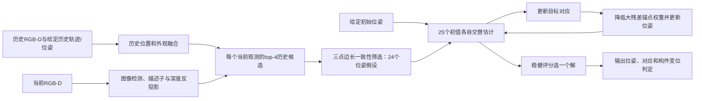

# 当前算法说明、实际运行例子与历史位姿误差实验

## Material Passport

- 日期：2026-10-22；状态：算法说明、实际轨迹重放、历史误差实验均完成。
- 当前已验证主干：v4几何候选采样＋对应/位姿交替估计＋残差变位判定。
- 本轮研究分支：v5协方差融合、方差归一化候选与关联；与普通加权历史融合单独对照。
- 数据：128个已有RGB-D基础场景×4种历史误差条件=512个应力案例，3种方法1,536条评估。不是512个新独立视觉场景，没有重新渲染图像。
- 新实验：`results/history_uncertainty_v1/`；实际v4案例：`results/current_algorithm_trace_v4_0250/trace.json`。

## 一、算法到底在做什么

输入是若干次历史观测与当前RGB-D观测，输出是当前观测对应的历史构件身份、当前相机到历史地图的SE(3)变换，以及对应构件是否发生粗尺度变位。

当前主模块是**跨次视觉关联与状态估计**。实现是显式几何估计器，尚没有训练型视觉网络、语言理解器、新规划或控制算法。它只保留一次最终选中的估计，不维护完整多峰后验；历史主要用于构件测量融合，不是复杂事件记忆。几个版本号是项目开发版本，不代表已有同名论文算法。



### 1. 从图像形成观测

当前像素中用颜色连通区域检测构件，从检测框的2×4亮度块形成8维归一化外观描述子g_i；区域内深度反投影点的均值作为当前位置y_i。该前端是简化仿真测量前端，尚不等于真实复杂场景的视觉识别。

历史中第j个构件在第h次的观测位置记z_hj，外观记f_hj。历史轨迹身份目前由标注给定，当前身份隐藏。v4取位置与描述子均值作为历史参考x_j、f_j。未被当前看到的目标不直接判为消失。

### 2. 外观只给候选，不立即固定身份

计算d_ij=‖g_i−f_j‖²/σ_f²，σ_f=0.18。每个当前观测保留代价最小的4个历史候选。重复外观下，外观排名第一的目标不一定是正确身份。

### 3. 三点几何生成多个初始位姿

随机取三个当前观测，枚举它们各自top-4历史候选的组合，最多64种；排除重复历史身份和退化三角形。比较三条边长，选取

\[
 E(J|I)=\sum_{a<b}\frac{(\|y_{i_a}-y_{i_b}\|-\|x_{j_a}-x_{j_b}\|)^2}{\sigma_g^2}
 +\lambda\sum_a d_{i_a,j_a}
\]

最小的历史三元组，用SVD拟合一个SE(3)位姿。σ_g=0.12m，λ=0.25。

重复24次，加上给定初始位姿，共25个初值。这里是代价排序，不是要求三条边严格相等；含变位或遮挡偏差的三点仍可能形成有用的粗初值。不会只保留一个外观硬匹配后再随机取点。

### 4. 对应与位姿交替更新

对每个初值迭代8次，先用匈牙利算法更新一对一对应A：

\[
 A\leftarrow\arg\min_A\sum_i\left[\lambda d_{i,A_i}+\|Ty_i-x_{A_i}\|^2/\sigma_g^2\right].
\]

然后计算r_i=‖Ty_i−x_Ai‖，以

\[
w_i=\frac{1}{1+(r_i/0.18)^4},\qquad
T\leftarrow\arg\min_{T\in SE(3)}\sum_iw_i\|Ty_i-x_{A_i}\|^2
\]

更新位姿。后一步用加权SVD。大残差点可能真的变位，也可能对应错误；不应让它们强行把整个配准拉过去。但它们仍参与身份判断，这正是关联与配准锚点作用的区分。

该权重是稳健启发式，不是经过概率校准的“构件未变化概率”。算法也没有全局最优或精确EM收敛保证。

### 5. 从25个最终解中选一个

评分为Σ_i[λd_iAi+min(r_i²/σ_g²,9)]，选择最低者，输出T*与A*。完整几何残差用于关联排序，截断残差用于最终解选择；两者用途不同。

### 6. 输出变化判断

目前r_i>0.25m报告对应构件变位，否则报告未检出超过门限的变位。它不是“任意损坏检测”，不能识别毫米裂缝，也没有自动处理新生、永久消失或复杂物体分裂合并。

## 二、一个来自实际保存运行的例子

下面不是编造的数字，来自上一批RGB-D场景250的v4重放。该场景为高初始位姿误差、重复外观、真实变位与前景遮挡同时存在。真值身份仅用于下面核对，不是算法输入。

最终选中第4个初值发展出的解。它的三个当前观测为[2,11,9]：

| 当前观测 | 外观top-4历史候选 | 旧全局外观硬对应 | v4该三元组选择 | 评价身份 |
|---|---|---:|---:|---:|
| 2 | 18,2,22,10 | 18 | 22 | 22 |
| 11 | 5,21,9,1 | 21 | 1 | 1 |
| 9 | 19,3,7,11 | 3 | 11 | 11 |

当前三条边约[4.248,2.580,4.900]m，选中历史三条边约[4.319,2.654,4.769]m。这个三元组包含实际变位点，所以边长并不完全一致；候选仍足以进入后续联合优化。不能因此把几何一致性解释为严格不变条件下才准入。

最终估计下：

- 历史构件23对应当前观测1，残差0.0230m，稳健配准权重约0.9997，报告未变位。
- 历史构件18对应当前观测0，残差0.5171m，权重约0.0145，报告变位。

第二个点仍被识别为构件18，但对配准的影响只有小残差点的约1.45%。这就是“识别它是谁”与“是否让它作为配准锚点”的实际区别。案例选择用于解释失败修复，不作为代表性成功率；总体结果仍见v4报告。

## 三、本轮继续实现了什么

历史位姿不准确时，简单均值可能被低质量历史帧污染。本轮将每帧的SE(3)扰动一致地作用于该帧所有历史构件位置；等价于在相同图像测量上使用有误差的历史相机位姿，不重新生成随机描述子。

对每次历史测量，按声明的位姿噪声协方差传播：

\[
C_{hj}\approx J_{hj}\Sigma_hJ_{hj}^{T}+\sigma_m^2I,
\qquad J_{hj}=[I,-[z_{hj}]_\times].
\]

使用观测位置做一阶近似，σ_m=0.02m。算法得到的是噪声等级/协方差，不得到这次实际施加的误差变换；协方差准确性仍是本轮的假设。

**普通加权历史参照**先做GLS融合：

\[
\bar C_j=(\sum_hC_{hj}^{-1})^{-1},\quad
\bar x_j=\bar C_j\sum_hC_{hj}^{-1}z_{hj},
\]

随后运行原v4。这样可区分普通历史降噪与新估计步骤的收益。

**v5研究分支**在同一GLS融合后，进一步将候选边长代价按投影方差归一化；关联代价使用马氏距离与log-determinant项，配准权重结合标准化残差和协方差大小。位姿仍用标量协方差权重的SVD近似，不是精确的各向异性SE(3)优化。0.25m变化阈值保持相同，没有通过新增拒判来抬高F1。

点级融合没有完整建模同一历史帧引起的跨构件误差相关性，也没有联合优化全部历史相机位姿。共同的全局坐标系偏差作为独立的规范自由度评价，不伪装成各点独立噪声。

## 四、128个基础场景的历史误差实验

每种条件复用同样128个基础场景（原256场景每个视觉条件固定取前8个），不按成功与否筛选。共512个应力案例×3方法=1,536条评估。

| 历史条件 | 注入误差 |
|---|---|
| 准确历史 | 不额外扰动 |
| 同质量历史 | 每帧独立0.08m平移标准差、1°旋转向量分量标准差 |
| 混合质量历史 | 3帧0.015m/0.2°，另3帧0.20m/3° |
| 共同偏差 | 6帧共有0.15m/2°的全局坐标偏差，另有每帧0.015m/0.2°独立误差 |

下表“位姿通过”仍采用≤10cm且≤3°：

| 条件 | v4绝对位姿通过率 | GLS历史＋v4 | v5完整不确定性分支 |
|---|---:|---:|---:|
| 准确历史 | 100% | 100% | 100% |
| 同质量历史 | 61.72% | 61.72% | 61.72% |
| 混合质量历史 | 11.72% | 100% | 100% |
| 共同偏差 | 0.78% | 0.78% | 0.78% |

混合质量条件中，GLS历史参照把平移误差中位数从0.184m降到0.0280m。它相对v4的通过率差88.28个百分点，逐场景配对、视觉条件内分层bootstrap探索95%区间[82.81,92.97]个百分点。**这项收益已经由普通协方差加权解释，不能归给v5新关联/候选步骤。**

v5相对GLS参照在同质量条件的变化F1仅从0.9155到0.9233，差0.0078、探索区间[0,0.0195]；其他三个条件F1相同。v5运行约35.8–39.2ms，GLS参照约27.1–30.5ms，本轮没有证据支持以额外复杂度换取稳定收益。不将v5当作已胜出的主干替换。

## 五、为何共同偏差必须单独解释

若所有历史点共同经历E，则匹配得到的变换自然可能是ET，而非T。仅凭当前与历史相对观测，没有外部绝对锚点无法唯一分离E和T。

共同偏差条件中三个版本：

- 相对真实世界的绝对位姿通过率都只有1/128，中位平移误差约0.451m。
- 相对历史坐标规范ET的位姿全部通过，中位误差约0.020m。
- 变化F1都保持0.9155，身份准确率也基本不变。

因此这类绝对位姿退化不能直接宣称为变化识别失败，也不能用额外不确定性模块“恢复绝对精度”的叙述掩盖不可观测性。两个坐标评价并列保留；不是在看到失败后只挑有利指标。

## 六、当前应怎样理解研究进度

已完成的算法主干是v4；本轮确认普通协方差加权应作为重要参照，同时实现v5进行检验，尚未得到其稳定额外收益。

新增误差条件的主要退化发生在绝对位姿，变化F1大多不变。这不能用来证明新的变化感知机制必要。下一步应针对真正改变相对证据的历史轨迹拼接错误、局部地图变形或非平面视角偏差，明确要更新的算法机制，并与现有强几何方法比较；不把整个SLAM坐标系漂移当作巡检变化识别的独特困难。

目前v4的几何筛选、匈牙利匹配、加权SVD等都是成熟技术组成部分。项目已形成可运行、可归因的机制原型；这些模块的组合尚不能直接称为已确立的独立原创贡献。

## 七、文件与验证

- 说明案例脚本：`scripts/explain_current_algorithm.py`；场景250追踪：`results/current_algorithm_trace_v4_0250/trace.json`。旧场景103追踪保留在`results/current_algorithm_trace_v4/`，不覆盖。
- v5：`scripts/joint_estimation_v5.py`；实验：`scripts/run_history_uncertainty.py`；分析：`scripts/analyze_history_uncertainty.py`。
- 冻结配置：`configs/history_uncertainty_v1.json`；主表：`results/history_uncertainty_v1/summary.csv`；详细统计：`analysis.json`；图：`comparison.png`，已目视检查。
- 3个功能测试通过：精度加权均值/协方差、位姿扰动雅可比、共同坐标偏差不能由相对观测恢复绝对位姿。
- 4,809项源码/输入哈希、协方差正定性、坐标旋转不变性和确定性重放检查通过；每个应力条件重放16个基础场景的全部方法，所有评分与候选覆盖字段一致。检查数量不是研究效能。
- 本轮预测约55.2秒，无新增依赖或外部下载。128基础场景在四条件重复，未把512案例当512独立场景；配对区间在各条件分别按基础场景重采样，不混合伪增样本。
- 原v1–v4、全部RGB-D原始数据和旧实验结果保持不变。运行器拒绝覆盖；已有实验可重放分析：

```powershell
$env:PYTHONUTF8='1'
$env:MPLCONFIGDIR=Join-Path (Get-Location) '.cache\matplotlib'
.venv\Scripts\python.exe -m unittest tests.test_history_uncertainty -v
.venv\Scripts\python.exe -m scripts.analyze_history_uncertainty
```
